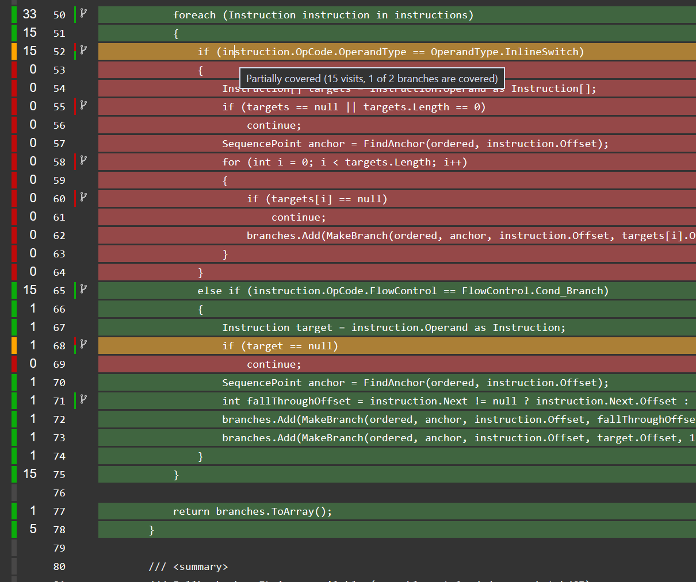

# Code Coverage Branch Enricher (`com.kryeker.codecoverage-branch`)


*Enriched HTML report: the Branch Coverage column is populated (here `BranchSynthesizer` at 78.3%) instead of staying at zero as with stock `com.unity.testtools.codecoverage`.*

Standalone Unity package: wrapper over `com.unity.testtools.codecoverage@1.2.7`
that backfills synthetic OpenCover `<BranchPoint>`s into coverage XML, so HTML /
Cobertura / SonarQube reports show a branch-coverage column.

## Problem this package solves

The stock Code Coverage package (`com.unity.testtools.codecoverage`) only reports
**line (sequence-point) coverage** — its own branch coverage is officially not
implemented. From the
[Technical details → Known limitations](https://docs.unity3d.com/Packages/com.unity.testtools.codecoverage@1.2/manual/TechnicalDetails.html)
page (v1.2):

> NPath Complexity calculation and Branch Coverage are not implemented at present
> so they will always appear as zero in the coverage report.

The same note is repeated in
[How to interpret the results](https://docs.unity3d.com/Packages/com.unity.testtools.codecoverage@1.2/manual/HowToInterpretResults.html):

> Currently, the NPath Complexity and Branch Coverage aren't calculated,
> so will always appear as zero.

In practice this means every OpenCover XML ships with empty `<BranchPoints>` and
`branchCoverage="0"` at method/class/module/session level, so the Branch Coverage
column in HTML, Cobertura and SonarQube reports is always zero and any
branch-coverage quality gate trivially fails.

**This package fixes that**: after each coverage session it backfills synthetic
`<BranchPoint>`s into the XML and recalculates `branchCoverage` at every level,
so the reports show a meaningful branch-coverage column.

## Why synthetic

Unity's `UnityEngine.TestTools.Coverage` API only exposes **sequence points**
(`line/column/hitCount/ilOffset`). The stock `OpenCoverReporter` therefore always writes
empty `BranchPoints`. This package disassembles each covered method's IL (via the
`Mono.Reflection` copy vendored inside the coverage package) and emits two branch paths
per conditional branch (`Cond_Branch`: fall-through + target) and one per `switch` target.

**Visit counts are heuristic**: a path counts as visited when the sequence point at its
target IL offset was hit. This is an approximation, not instrumentation — treat the
branch % as directional, not exact.

When the covered assembly is not loaded (batch/CI context), the enricher falls back to
one branch path per sequence point (`SynthesizeFromSequencePoints`), so the branch
column is still populated.

## Wiring

- `BranchCoverageEnricher` (`[InitializeOnLoad]`) subscribes to
  `UnityEditor.TestTools.CodeCoverage.Events.onCoverageSessionFinished` and enriches every
  result XML in `SessionResultPaths` in place (skips `*_fullEmpty.xml` baselines).
- `BranchEnricherMenu` adds `Tools > Code Coverage > Enrich Branch Points In OpenCover XMLs...`
  for re-running enrichment over an existing results folder.
- `BranchSynthesizer` holds the IL → `BranchPoint` logic; `EnrichFile(path)` is public so
  CI scripts can call it after a batch run and before ReportGenerator.

## Install

Via git URL in `Packages/manifest.json`:

```json
"com.kryeker.codecoverage-branch": "https://github.com/Kryeker/unity-codecoverage-branch.git#v1.0.0"
```

Or as a local folder during development:

```json
"com.kryeker.codecoverage-branch": "file:../unity-codecoverage-branch"
```

Requires `com.unity.testtools.codecoverage: 1.2.7` (declared in this package's `package.json`).

## Tests

`Tests/branch-example.xml` is a hand-written fixture showing the enriched output shape
(4 sequence points → 4 branch points, `branchCoverage="75.00"`).

`Tests/Editor/BranchSynthesizerTests.cs` (EditMode, NUnit) covers the pure synthesis
logic: `SynthesizeFromSequencePoints` (visited/unvisited mapping, ordinal/usp id
sequencing, null/empty guards) and `Synthesize` guards (null method, empty points,
method without IL body).

## License

MIT — see [LICENSE.md](LICENSE.md). Changelog: [CHANGELOG.md](CHANGELOG.md).

## C# level

C# 7.3 (Unity 2020.3 policy): no nullable reference types, no `System.Text.Json`, no
`ValueTask`/`Range`/`Index`.
